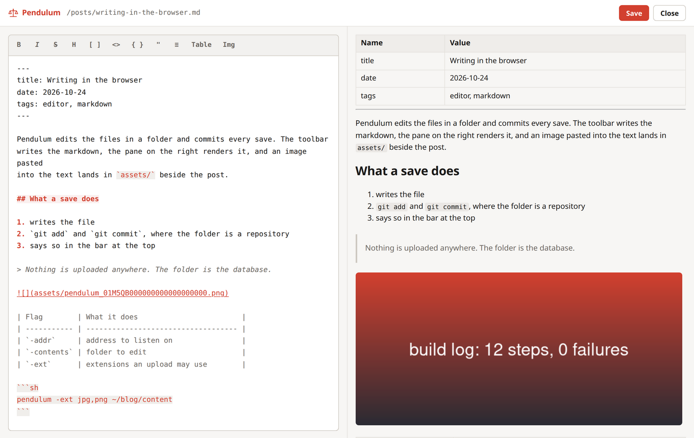

# Pendulum

An editor for the markdown and text files in a folder. It runs where the files are, saves them in place, and commits every save when the folder is a git repository.



## Run it

```sh
go install github.com/titpetric/pendulum/cmd/pendulum@latest
pendulum ~/blog/content
```

Binaries for linux, macOS and windows are on [the releases page](https://github.com/titpetric/pendulum/releases/latest). In docker, mount the folder to edit:

```sh
docker run -d --name pendulum --restart=always \
	-p 8080:8080 \
	-v $(pwd):/app/contents \
	titpetric/pendulum
```

Either way the editor is on [localhost:8080](http://localhost:8080/).

| Flag        | Default                     | What it does                 |
|-------------|-----------------------------|------------------------------|
| `-addr`     | `:8080`                     | address to listen on         |
| `-contents` | `.`                         | folder to edit               |
| `-ext`      | `jpg,jpeg,png,gif,svg,webp` | extensions an upload may use |

The folder is also a bare argument, which is the shortest way to start: `pendulum docs`.

## Writing

The editing surface is [mdedit](https://github.com/titpetric/mdedit): a toolbar over a textarea, with the markdown source highlighted as it is typed. The pane beside it renders through the same server, so the preview shows what the file holds.

Ctrl-S saves. A save writes the file, then `git add` and `git commit` where the folder is a repository and git has an identity configured. Everything stays on the machine the editor runs on.

## Uploads

Paste an image into the text, drop one onto it, or pick one with the toolbar. The file lands in an `assets/` folder beside the document, under a name the server chooses:

```
posts/writing-in-the-browser.md
posts/assets/pendulum_01M5QAKP5G4P644PEWM5MSCF90.png
posts/assets/pendulum_01M5QAKP5G4P644PEWM5MSCF90.json
```

The markdown gets a relative link, ``, so whatever publishes the folder resolves it the same way the preview does. The name the browser sent decides nothing except the extension; it is kept in the `.json` beside the file, along with the size, the content type, the sha256 and the document it belongs to.

`-ext` is the allowlist. `pendulum -ext jpg,png` stores those two and turns everything else away, with the reason shown in the editor.

## What the preview understands

A folder of posts carries conventions markdown has no syntax for, and the preview reads them:

| In the source                | In the preview                     |
|------------------------------|------------------------------------|
| `---` front matter block     | a table of the fields              |
| `A> aside`                   | a blockquote, as leanpub writes it |
| `{pagebreak}`, `<!--more-->` | a page break                       |
| ``   | an image                           |

A relative image resolves against the document: beside it, in a folder named after it, in its `assets/` folder, or under `/images` where the document sits under `/post`.

## Build

| Command        | What it does                                 |
|----------------|----------------------------------------------|
| `make test`    | `go vet` and `go test ./...`                 |
| `make build`   | the binary, in `build/`                      |
| `make release` | the release matrix, linux, macOS and windows |
| `make docker`  | the image                                    |
| `make mdedit`  | refresh the vendored editor bundle           |

The frontend is HTML, CSS and ES modules under `front/`, built into the binary with `embed`. There is no node toolchain and no build step: what is in the folder is what the browser receives. `make mdedit MDEDIT=../mdedit` copies a newer editor bundle in from a checkout of [mdedit](https://github.com/titpetric/mdedit).

Written by [@TitPetric](https://github.com/titpetric), licensed under [WTFPL](http://www.wtfpl.net/txt/copying/).
