# mdedit

A markdown editor that writes markdown. One surface holds the source, the stylesheet styles every construct where it stands, and the markers show or hide at the press of a button. A heading starts as `###` and reads at a heading's size from the third character on.

| Markers shown                                                                                  | Markers hidden                                                                                   |
|------------------------------------------------------------------------------------------------|--------------------------------------------------------------------------------------------------|
| [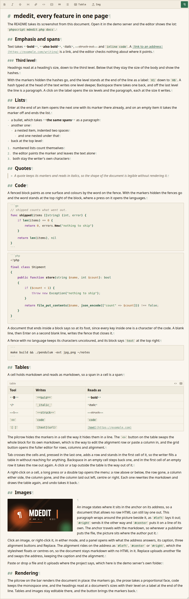](docs/editor.png) | [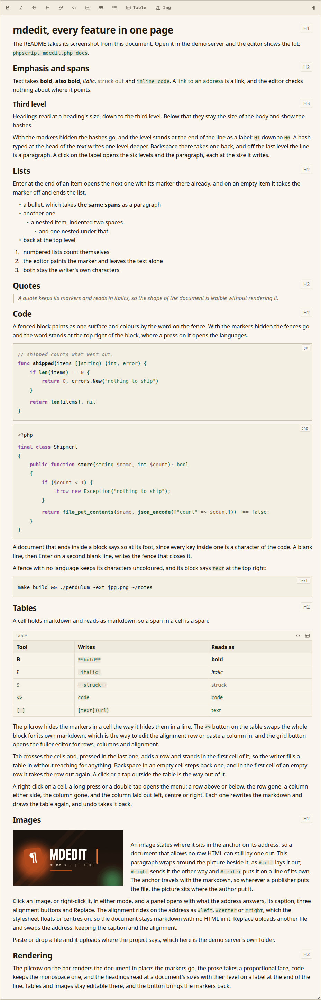](docs/render.png) |
| the pilcrow pressed: `###`, `**`, the fences and the line ends                                 | the pilcrow released: the same document, the same caret                                          |

| A table in the document                                                                                                            | The image panel                                                                                                              |
|------------------------------------------------------------------------------------------------------------------------------------|------------------------------------------------------------------------------------------------------------------------------|
| [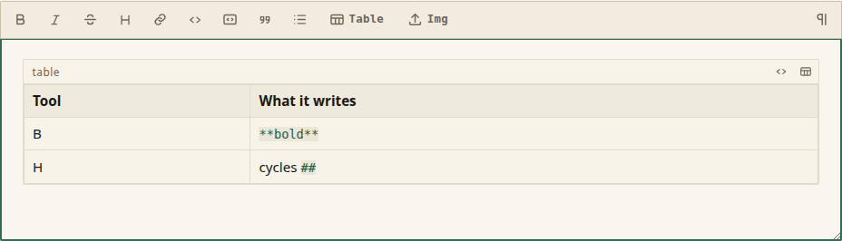](docs/table.png) | [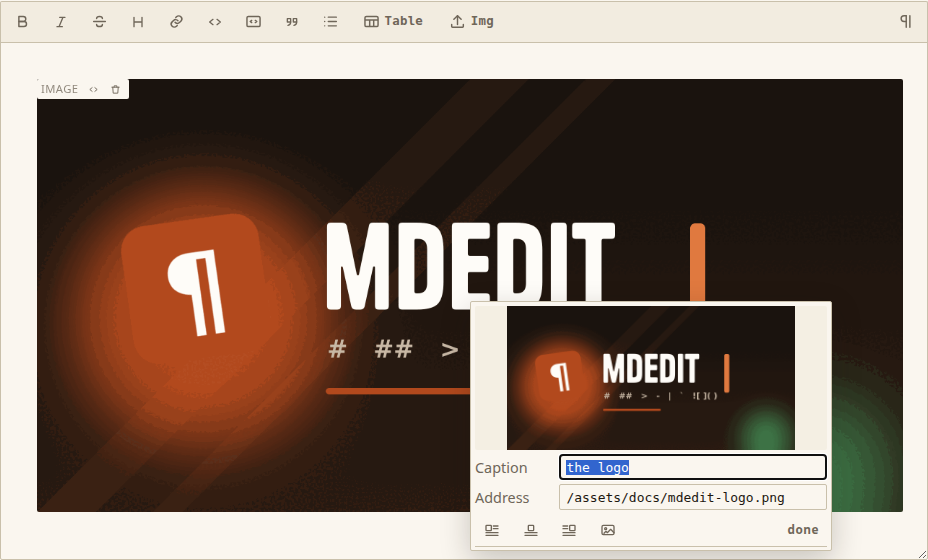](docs/image.png) |
| edits in place; `<>` shows its markdown, the grid opens over it                                                                    | a click, a right-click or a tap on any image                                                                                 |

| A file on its way, in the document                                                                                                                                  | The queue over every file                                                                                                                                               |
|---------------------------------------------------------------------------------------------------------------------------------------------------------------------|-------------------------------------------------------------------------------------------------------------------------------------------------------------------------|
| [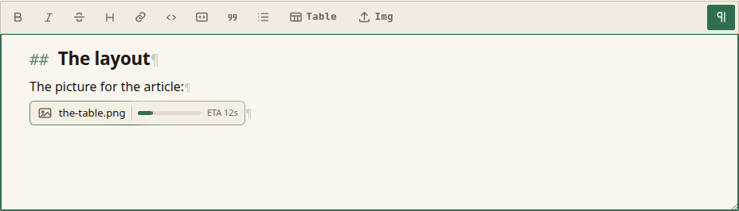](docs/upload.png) | [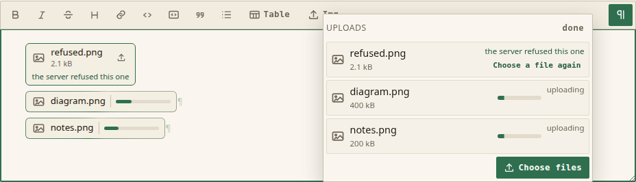](docs/upload-queue.png) |
| the preview in place of the placeholder: name, bar and estimate, no character of the document, no byte of the caret                                                 | the image list manager: a gallery uploads as rows, each with its own bar and its next move                                                                              |

The document is markdown throughout: what the surface holds is the source, character for character, and a save writes the characters on screen. The textarea it mounts over stays in the page, hidden, holding `name` and `value` for the form and for a browser with no JavaScript. No dependencies, one stylesheet, one module.

## Step by step

Each row is one step, in the order most projects take them. The last column says where the details are.

| Step | What you do                                                      | Where                                                                  |
|------|------------------------------------------------------------------|------------------------------------------------------------------------|
| 1    | Look at it: serve the demo and open a document                   | [Test server / demo](#test-server--demo)                               |
| 2    | Copy `dist/` into the project and mount it over a textarea       | [Install](docs/integration.md#install)                                 |
| 3    | Pick the toolbar, the tab key and whether markers start visible  | [Options](docs/integration.md#options)                                 |
| 4    | Point `uploads` at an endpoint that answers `{"url": ...}`       | [Uploads](docs/integration.md#uploads)                                 |
| 5    | Set the colours, the fonts and the line spacing                  | [Theming](docs/integration.md#theming)                                 |
| 6    | Copy the image and player rules into the page that publishes     | [Publishing the document](docs/integration.md#publishing-the-document) |
| 7    | Draw the project's own markers as cards                          | [Cards](docs/integration.md#cards)                                     |
| 8    | Read and drive the editor from script                            | [API](docs/integration.md#api)                                         |
| 9    | Run the test suites and rebuild `dist/` after a change to `src/` | [Development](docs/development.md)                                     |

## Install with Composer

Install the package into `ext/`, not `vendor/`: a Go module zip omits `vendor/`. A copy under `ext/` is the one a `go:embed` and the module proxy can see. Add this to the project's `composer.json`:

```json
{
  "repositories": [{"type": "vcs", "url": "https://git.cdn.si/titpetric/mdedit"}],
  "require": {
    "titpetric/mdedit": "dev-main",
    "oomphinc/composer-installers-extender": "^2.0"
  },
  "config": {"allow-plugins": {
    "composer/installers": true,
    "oomphinc/composer-installers-extender": true
  }},
  "extra": {
    "installer-types": ["mdedit-asset"],
    "installer-paths": {"ext/{$name}": ["type:mdedit-asset"]}
  }
}
```

`composer install` writes it to `ext/mdedit`; load `ext/mdedit/dist/mdedit.min.js` and `.min.css` from the page.

## What it does

- **The surface.** Every construct keeps the characters the writer types; the pilcrow hides them and the line reads as it publishes. [The surface](#the-surface)
- **Headings.** Typed with hashes, sized where they stand, with a level label from `H1` to `H6` and a chooser that moves the level. [Headings](#headings)
- **Shortcuts.** Ctrl+B, Ctrl+I, Ctrl+Shift+X and Ctrl+Shift+S decorate the selection, and a second press takes it off.
- **Lists and quotes.** Enter continues a list at its depth; a quote keeps its markers and reads in italics. [Lists and quotes](#lists-and-quotes)
- **Code.** A fenced block draws as one surface and colours by the word on the fence, with no parser and no dependency. With the markers hidden the block's top edge names that word, and a press on it opens the languages. [Code blocks](#code-blocks)
- **Tables.** Pipe rows draw as a table, edited cell by cell, with a grid over it and a menu for the structural edits. [Tables](#tables)
- **Front matter.** A `---` block at the head draws as fields, with a YAML source view and a button for the next field. [Front matter](#front-matter)
- **Images.** Paste, drop or pick; the panel edits the caption, the address and the alignment that floats it in the prose. [Images](#images)
- **Media and files.** A link to a playable file draws a player; a document alone on its line draws its own chip; every block draws a source toggle and a delete. [Media and files](#media-and-files)
- **Uploads.** The line draws the file on its way, a failure reports its reason and reopens the picker, and the queue panel is the image list for a gallery upload. [Uploads](#uploads)
- **Links.** With nothing selected, the link tool opens one numbered table over every link in the document, the addresses edited as drafts and written by Save. [Links](#links)
- **Cards.** A host's own marker draws a block of its own, in a shadow root, without touching the document. [Cards](docs/integration.md#cards)

## The surface

The surface holds the markdown itself. The editor tokenises each line as the writer types, and the tokens hold the writer's own characters, so the document and what is on screen are the same string: `editor.value` reads the surface back, and the hidden textarea takes every edit for the form.

Typing `###` and a space turns that line into a heading under the caret, and the word that follows takes the heading's face. The same holds for `**`, ```, `>`, `-`, `1.` and a fence: the editor recognises the construct as the writer types it, and re-reads only the line under the caret.

The pilcrow at the right of the bar decides whether the marker characters show.

| Pilcrow  | What the surface shows                                                      |
|----------|-----------------------------------------------------------------------------|
| pressed  | `###`, `**`, the fences, the pipes and a mark at the end of every line      |
| released | the same document with the markers hidden, the same caret, the same editing |

`editor.toggleMarks(on)` does it from script, the `marks` event reports it, and `marks: false` opens with the markers hidden.

Prose takes `--mdedit-prose-font` and code takes `--mdedit-code-font`. One surface draws both, so a document reads in a prose face while its code stays monospace.

## Headings

A heading draws at its level from the first character of the text, so a document reads in its own outline while the writer types. The hash marks stay where the writer put them and hide with the pilcrow.

With the markers hidden a heading names its level at the end of the line, as a label from `H1` to `H6`. The label is the way back to the characters it stands for: a click opens the six levels and the paragraph, a hash typed at the head of the text writes one level deeper, and Backspace there takes one back, leaving a paragraph off the last level. The label holds no text of its own, so nothing it draws can land in what the form posts.

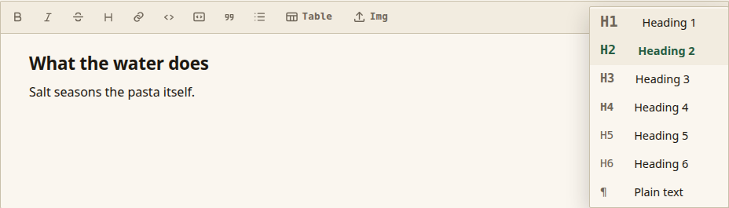

## Lists and quotes

Enter at the end of a list item opens the next one with its marker already there, at the same depth, and a numbered list counts on. Enter on an item with nothing in it takes the marker off and leaves the blank line markdown wants between a list and the paragraph under it. Shift-Enter writes markdown's hard break.

A quote keeps its `>` markers and reads in italics, so a passage of quoted text stands apart from the prose around it while the source stays readable. Tab and Shift-Tab indent a selection, so a list nests at whatever depth the writer sets.

## Code blocks

A fenced block draws as one surface, fences included, and the writer types into it where it stands. Tab writes a tab into the block.

With the markers hidden the fences go and the block reads as one box. The word on the opening fence stands at the top right of the block, and a press on that label opens the languages: bash, css, go, html, js, json, php, python, sql, ts, yaml, and plain text for a fence that names none. The field above the list filters it, and Enter writes the word in the field. A fence keeps a language the list does not hold. Choosing one writes the word onto the opening fence. The colourer reads the lines below in it. A fence that names no language, or names `text`, keeps its characters uncoloured.

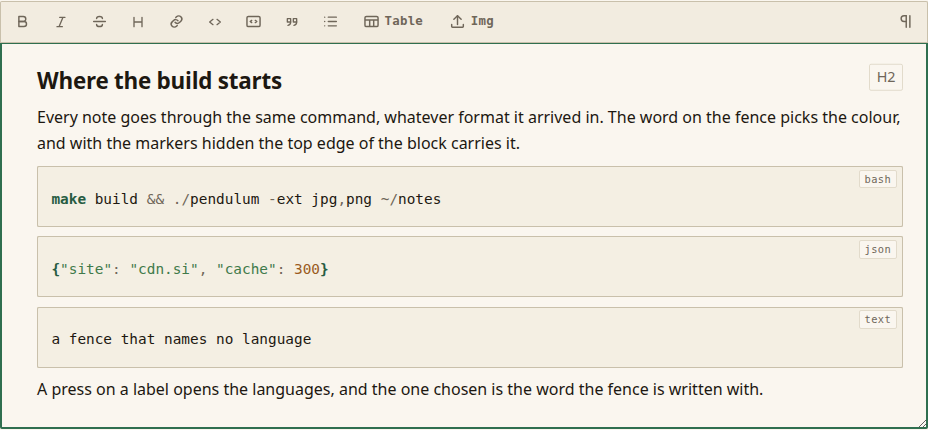

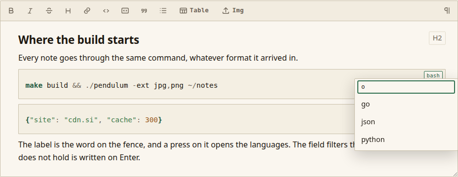

A regex and a bag of words colour the code inside, with no parser and no dependency. The word on the opening fence picks the bag; a fence with no word has none to pick:

| Fence                         | What colours                                                                                    |
|-------------------------------|-------------------------------------------------------------------------------------------------|
| ` ```go`                      | the common words, plus go's own keywords, its sized types and its builtins                      |
| ` ```php`                     | the common words, plus php's keywords, `$variables`, `Exception` and its builtins               |
| ` ```bash`                    | the common words, plus shell's control words, `$variables` and the commands it runs             |
| ` ```python`                  | the common words, plus python's keywords, its builtins and `True`, `False`, `None`              |
| ` ```js`, ` ```ts`, ` ```sql` | the common words, plus that language's own list of words                                        |
| any other word                | the common set: declarations, control words, types, strings, numbers, comments, brackets, calls |
| no word, or `text`            | no colour: the lines are the characters they are                                                |

An alias answers the name it stands for: `golang`, `shell`, `sh`, `yml`, `javascript`, `typescript` and `py` resolve to the word they mean, and `plain`, `plaintext` and `txt` mean no language at all.

The classes are `.mdedit-c-declare`, `-keyword`, `-type`, `-builtin`, `-call`, `-string`, `-number`, `-comment`, `-variable`, `-bracket`, `-operator`, and four variables colour them: `--mdedit-keyword`, `--mdedit-string`, `--mdedit-number`, `--mdedit-comment`.

It reads one line at a time, so a string or a comment that spans lines ends at the line break. That is the trade for a colourer that cannot wedge itself into a bad state while someone types an opening quote.

A fenced block takes every key as a character of the code, Enter included, so a document that ends inside one says so at its foot and `--mdedit-fence-hint` is what it says. A blank line, then Enter on a second blank line, closes the block: the two lines typed to escape go, the editor writes the fence that opened it again, and the caret lands below.

## Tables

A block of pipe rows draws as a table in the document, cells editable where they stand. `**bold**` in a cell reads bold, and what the writer types goes back into the pipes as they type it, padded so the source reads as a table too.


Two buttons ride on the widget: `<>` swaps it for its own markdown while the caret is in it, and the grid button opens the fuller editor, which adds and removes rows and columns and cycles a column between left, centre and right. The table button on the toolbar opens that grid from the caret, and writes a new table anywhere else.

### Crossing it

| Key                        | In a drawn table                                                |
|----------------------------|-----------------------------------------------------------------|
| Tab                        | the next cell, with what it holds selected                      |
| Tab in the last cell       | a row of empty cells, and the caret in the first of them        |
| Shift-Tab                  | the cell before, and the first cell keeps it                    |
| Backspace in an empty cell | the cell before, caret at the end of it                         |
| Backspace in an empty row  | the row goes, from its first cell, and the caret lands above it |

Tab keeps growing the table while the caret sits at its foot, so the writer fills a table in without reaching for anything, and Backspace takes an empty row back out. The way out of a table is a click or a tap outside the table: neither Tab takes the focus out of the document.

### The menu over it

A right-click on a cell, a long press, or a double tap or double click, opens every structural edit markdown has for a table:

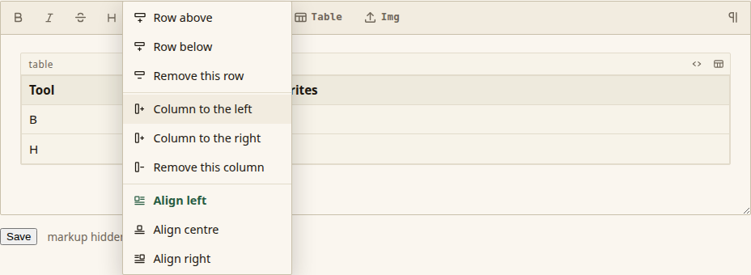

Each item rewrites the block's markdown and draws the table again, so the document is the edit and the drawing follows it; undo takes any of them back. The three alignments are what a markdown alignment row can say - `---`, `:---:` and `---:` - and the menu marks the one the column takes. The menu lists the header row and the last column as refused: markdown has no table without either.

## Front matter

A document that opens with `---` and closes the block with `---` or `...` draws as a two-column table labelled "Document front-matter". Root values are edited where they stand. One level of a root object opens under its own name.

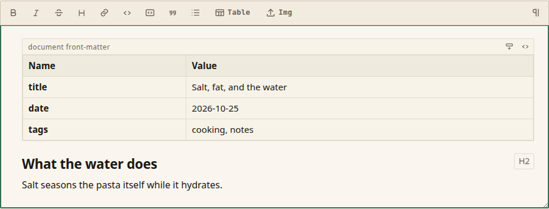

A list, a flow collection, a block scalar or an object below the first level is too rich for a cell: the row shows its key and `rich type, edit via source`, and the source view is where it changes. A block that is not a map of `name: value` lines stays markdown.

The `<>` button swaps the table for the whole block as YAML in a monospace textarea. The same button parses the text and draws the table again; a block with no closing delimiter keeps the source view. The add-field button writes a root-level key and value. A row with no key writes nothing.

What is typed is a string. A value that would read as another YAML type or needs a quote is double-quoted and escaped. A line nobody edited is written back exactly as it came in.

A comment, a reply or a chat message holds no metadata. A host that exposes none passes `frontmatter: false`, which leaves a leading `---` block as markdown.

## Images

Paste, drop or pick a file and it uploads where `uploads` says. Click an image in either view - a right-click does it too, and a tap where there is no mouse - and the panel opens over it:


The panel writes the caption and address back as the writer types. Replace uploads another file through the same uploader and swaps the address, keeping the caption and the alignment; with no uploader configured the button is absent.

Alignment rides on the address as an anchor, so the document stays markdown with no HTML in it:

```markdown


```

The stylesheet floats or centres on that anchor, and a floated picture takes a share of the column and no more, so the text beside it keeps a line worth reading. Headings, fenced blocks and tables set `clear: both`, so a float stops at the next band, and `--mdedit-image-gap` is the air around it.

The editor checks no address and rewrites none. Any public URL is a valid image here: the document is the author's, and whatever publishes it decides what it will fetch.

The page that publishes the document needs the same three rules; [the integration guide](docs/integration.md#publishing-the-document) has them.

## Media and files

The editor draws a link whose address names a file a browser can play as a player, in the editor and on the page that publishes the document:

```markdown
[Episode 3: the kitchen](assets/ep3.mp3)
[A walk through the build](https://example.com/clip.mp4)
```

The address is the whole of the contract - a markdown link states no type - so a file on the server and a public URL work the same way. Audio reads `mp3`, `m4a`, `aac`, `oga`, `ogg`, `opus`, `wav`, `flac`, `weba`; video reads `mp4`, `m4v`, `webm`, `ogv`, `mov`. A query or an anchor on the end changes nothing. The editor fetches nothing until the reader asks: a player loads its length and no more, so opening an article to fix a sentence costs no megabytes.

A publisher turns the same links into the same players. The editor draws `<audio>` and `<video>` with controls; a renderer that leaves them as links loses the player and nothing else.

Anything that is neither picture nor media uploads as a link named after the file:

```markdown
[minutes.pdf](/upload/01J9.../minutes.pdf)
```

The editor draws a link alone on its line whose address names a paper, an archive or a document - pdf, office and text formats, epub, zip and the like - as the file it names: its icon, its label and its extension, each a piece of generated content, so the chip adds no character to the document either. A link to a page stays a link.

A line of nothing but one picture, player or file draws a bar with three things: what the block is, a toggle that switches that one line to its own markdown, and a delete button that takes the line and its newline out of the document. The source view holds until the writer switches it back, and with the pilcrow hiding the markup this one line still shows its source.

## Uploads

Paste, drop or pick a file and the editor sends it to the endpoint the project configures. What the writer sees on the way is the subject here; the options and the request itself are in [the integration guide](docs/integration.md#uploads).

### The preview in the document

While a file is on its way the editor draws a preview in place of the placeholder: the kind of file, its name, a bar that fills as the bytes leave the browser and the time it has left, on one line that takes the room it needs and does not wrap. The placeholder's markdown steps out of view while the preview stands - there is no `` beside it to read past - and what a reader sees is the file, the bar and the estimate. The frame of the card draws a gradient that drifts slowly around it while the request runs, so the line says it moves without a spinner turning among the words and without anything blinking; it stops the moment the file lands or fails. Every part of it comes from attributes and adds no character to the document, so the markdown and the caret read as though the placeholder still stood on its own, and progress changes the drawing and nothing else - a request that takes a minute never writes into a document the writer has moved on in. Ten files paste at once as ten placeholders with ten previews, one under each line the writer is working on.

The estimate is the bytes left over the rate the request has kept since it began, said the way a person says it (`ETA 12s`, `ETA 1m 20s`). A browser that reports no byte counts leaves it unsaid and does not guess.

### Upload error handling

A request that fails leaves the placeholder where it landed and writes no message into the document: the preview standing on that line states the reason and one small button that opens the picker again. Choosing a file runs that line's request a second time, and the line stays put throughout - a second failure replaces the reason on the preview and nothing in the markdown, and a success replaces the placeholder with the marker the file stands for. A document that saw a failure reads exactly as it did before the writer chose the file, and the one sentence about what went wrong lives where the writer's eye already is, on the preview.

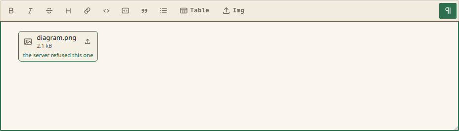

### The queue: a gallery's image list

The upload tool on the bar opens the queue - the management panel over the document, for a gallery upload as much as for one file. It lists every file the editor is sending, one row each, with its icon, name, size, bar and state, and it follows pasted and dropped files as well as picked ones. Ten files are ordinary there: the rows are the image list, each with its own bar and its one next move - try again after a failure, put it away once it has landed - and a button at the foot opens the picker for more. Escape closes the panel, and what is already on its way is in the list when it opens.


The preview and the row are the same request drawn twice: the line says what happened to the markdown the file will become, and the panel says what happens to every one of them at once.

## Links

The link tool writes a new link when the writer has text selected, and when they do not it opens the table over the links the document already holds. One table, one row a link, numbered in the order the document holds it:

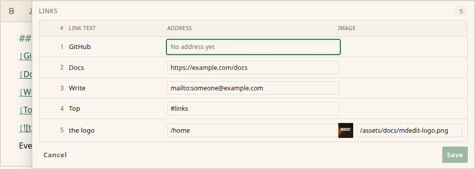

The table has four columns: the number the link holds, the text it reads as, the address it goes to, and - for a picture that links somewhere - the picture and the address it comes from. The picture column appears only in a document that holds a picture link, so a table with none reads as three columns and keeps the room for the addresses.

The rows hold drafts. Typing into an address changes its row and nothing else, so a half-typed address never lands in the markdown while the writer is still in the middle of it; the row tints until Save writes it. Save at the foot writes every changed address in one pass and closes the panel, and it waits disabled until a draft differs from the document. Cancel, a press outside the panel or Escape puts it away and leaves the document untouched.

An empty address is a row like any other. A writer types `[GitHub]()` and decides the address later; the panel is where the decision lands, and the field stays dashed until it holds something.

A picture inside a link is the link's picture:

```markdown
[](/home)
```

The row reads it as one link whose picture has an address of its own: the outer address is the page it goes to, the inner one names the file on show. Both are editable, and clicking the thumbnail opens the picture in a new tab. A picture of its own, with no link around it, is the image panel's, not this one's.

The panel reads links from the markdown, so it finds a link in a table cell or a card like any other; it skips what is code - a fenced block, a code span - because its brackets are text.

## Test server / demo

```sh
phpscript mdedit.php demo/data
```

One PHP script, run by [phpscript](https://github.com/titpetric/phpscript), serves the editor over a folder of markdown. It lists the files, saves what you write and stores pasted images behind a token minted at boot. Run it from this directory: phpscript roots the filesystem where it starts. The same script is the reference implementation of the upload contract, and [the development guide](docs/development.md#the-demo-server) covers how it works and how the test suites use it.

---

Next: [Integration guide](docs/integration.md)
